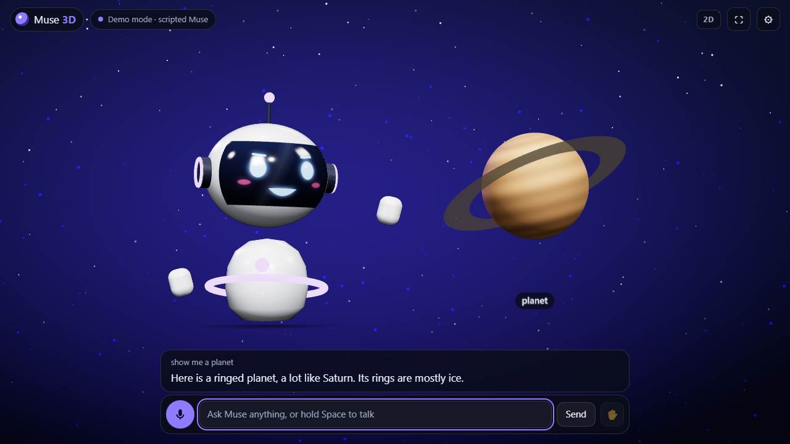

# Muse Avatar 3D

**Talk to Muse and it answers as a 3D avatar on any Leia display, glasses-free.** The avatar
looks at you as you move, reacts with expressions and gestures, lip-syncs Muse's voice, and
shows what it is talking about (images, 3D models, built-in objects, information cards) floating
beside it. The same page runs in 2D in any browser.



**Try it now, no hardware or account needed:**
[joehillthunder.github.io/displayxr-demos/apps/muse-avatar](https://joehillthunder.github.io/displayxr-demos/apps/muse-avatar/)
(starts in demo mode: try "hello", "show me a planet", "show me a picture", "what can you do").

> [!IMPORTANT]
> **About Muse.** This connects to your own Muse through Meta's open source
> [Muse Gadgets SDK](https://github.com/facebookincubator/muse-gadget-sdk). Each gadget needs an
> [SDK token](https://gadgets.muse.ai/settings/sdk-tokens) and you must accept the
> [Gadget SDK Terms](https://gadgets.muse.ai/sdk-terms). This project is not made, endorsed or
> supported by Meta. Everything except the live Muse connection works without a token.

## How it fits together

```
 Muse app (phone) ── pairs once over Bluetooth ──┐
                                                 ▼
 Muse (cloud) ◀── encrypted Noise session ── Raspberry Pi: muse-avatar bridge
                                              (Meta's musegadget + avatar commands)
                                                 │ ws://localhost:8765 (keyed)
                                                 │ over an SSH tunnel
                                                 ▼
                         Windows PC + Leia display: DisplayXR Browser → avatar page
```

- **`gadget/`** is a Python extension of Meta's **Linux Device SDK**. It runs in place of the
  stock `musegadget` service, with the same pairing and the same device in the Muse app, and adds:
  - **display commands** that Muse can call (the table below), registered next to the SDK's own
    `system.run`, `file.read`, `file.write` and `device.health`;
  - a **display hub**: a keyed WebSocket the page connects to;
  - a **chat pump** that sends what you type or say to Muse and streams the answer back:
    progress, reply text as it is written, and Muse's spoken voice (MP3).
- **The page** (`index.html`, `js/`) is one woven canvas built on
  [`@displayxr/inline3d`](https://github.com/DisplayXR/displayxr-web). It is vendored in
  `vendor/inline3d`, 1.37.1, the same build as `energy-grid`.

## What Muse can do through the avatar

| Feature | How |
|---|---|
| Talk by voice | Hold the mic button or <kbd>Space</kbd>. The page records a WAV voice note and sends it with `send_voice`. |
| Hands-free | Press ✋. The page detects speech, sends one note per sentence, and stops listening while Muse speaks. |
| Type | The text box sends with `send_chat`. |
| Spoken replies | Muse's own TTS voice, streamed as MP3 and played as it arrives, drives the mouth. Turn it off in settings for text-only replies. |
| Live progress | Muse's status ("Researching…", "Planning…") shows on screen, and the avatar shows thinking dots. |
| Muse-driven display | Muse calls the commands below by itself whenever they help the answer. |
| Proactive speech | Reminders and scheduled check-ins can use `avatar.say`, so the avatar speaks without being asked. |
| Other conversations | Optional captions of what Muse says in other chats on the same Muse. |
| Camera (experimental) | Start the bridge with `--vision` and a 📷 button appears to show Muse a still. |
| The gadget itself | Muse keeps the SDK's shell and file commands on the Pi, unless you start with `--no-system-commands`. |
| Your presence | `display.status` tells Muse whether someone is in front of the display (head tracking). The avatar waves when you step into view. |

### Display commands Muse sees

| Command | Parameters |
|---|---|
| `avatar.express` | `expression`: neutral, happy, excited, thinking, surprised, sad, confused, wink, love, sleepy · `seconds` |
| `avatar.gesture` | `gesture`: wave, nod, shake, shrug, bow, spin, celebrate, point_left, point_right |
| `avatar.say` | `text`, `expression`: speaks with the display's local voice |
| `display.show_image` | `url` (https) **or** `data_base64` + `mime_type` · `caption` |
| `display.show_model` | `url` of a glTF 2.0 file (.glb/.gltf, CORS-enabled) · `caption` · `spin` |
| `display.show_shape` | `shape`: planet, solar_system, dna, heart, globe, molecule, rocket, torus_knot, cube, crystal · `caption` · `color` |
| `display.show_card` | `title` · `body` · `bullets` (one per line, up to 6) · `accent` |
| `display.clear` | none |
| `display.set_depth` | `strength` 0–100 (stereo depth) · `pop` −100–100 (avatar behind or out of the glass) |
| `display.set_mode` | `mode`: `3d` or `2d` |
| `display.set_theme` | `theme`: night, aurora, ocean, sunrise, studio |
| `display.status` | none. Returns 3D or 2D, whether a viewer is tracked, the expression, the content and the theme. |

The bridge checks every parameter (`gadget/src/muse_avatar/commands.py`) before the page sees it,
and the page checks again.

## Set it up

**1. Demo mode (2 minutes, nothing to install).** Open the page in any browser. On the 3D PC,
open it in the [DisplayXR Browser](https://github.com/DisplayXR/displayxr-browser) for depth.

**2. Pair a Muse gadget** (Raspberry Pi 3B+/4/5/Zero 2 W, or any Linux box with Bluetooth LE).
Follow Meta's [Linux Device SDK guide](https://github.com/facebookincubator/muse-gadget-sdk/tree/main/linux):

```sh
curl -fsSL https://raw.githubusercontent.com/facebookincubator/muse-gadget-sdk/main/linux/install.sh -o install.sh
less install.sh     # read it first
bash install.sh --sdk-token mgst_…
```

Then pair it in the Muse app (Settings › Devices › Developer mode › Add Device, `MuseGadgetXXXXXX`).

**3. Add the avatar bridge** on the Pi:

```sh
git clone https://github.com/joehillthunder/joehillthunder.github.io
cd joehillthunder.github.io/displayxr-demos/apps/muse-avatar/gadget
sudo bash install-pi.sh                 # or --no-system-commands, --side-chat, --vision
```

It installs into the SDK's venv, swaps `musegadget.service` for `muse-avatar.service` (same
pairing), and prints the page address with your bridge key. Check it:
`sudo journalctl -u muse-avatar -f` should show `registered with the Muse` and
`display hub listening`.

**4. Connect the 3D PC.** The hub listens only on the Pi's `127.0.0.1`. Forward it over SSH,
using Windows' built-in OpenSSH:

```bat
ssh -N -L 8765:localhost:8765 pi@raspberrypi.local
```

Then open the address `install-pi.sh` printed (or run `sudo muse-avatar url` on the Pi) in the
DisplayXR Browser. It looks like
`https://joehillthunder.github.io/displayxr-demos/apps/muse-avatar/#bridge=ws://localhost:8765&key=…`.
The key travels in the fragment, so it never reaches GitHub. The page stores it in that browser
and removes it from the address bar. If the browser asks whether the site may reach devices on
your local network, allow it: that is the tunnel.

Going through `localhost` is deliberate. Browsers let an https page talk to `ws://localhost` and
use the microphone there, but not with `ws://raspberrypi.local`.

### Bridge options

| `muse-avatar run …` | |
|---|---|
| `--run-as USER` | Account Muse's shell and file commands run as (the installer passes yours). |
| `--no-system-commands` | Register only the avatar commands. |
| `--side-chat` | Talk in a dedicated Muse side chat instead of the main chat. |
| `--vision` | **Experimental.** Let the page send camera stills. The SDK documents file items only for WAV voice notes; this sends a JPEG the same way. |
| `--serve DIR` | Also serve the page itself from the hub (`http://localhost:8765/`), for offline kiosks. |
| `--host ADDR` | Listen somewhere other than 127.0.0.1. Anyone on that network who has the key can talk to your Muse as this device. |
| `--allow-origin URL` | Another site allowed to host the page. |

`sudo muse-avatar new-key` rotates the key. `sudo bash install-pi.sh --uninstall` puts the stock
service back.

## Develop

```sh
# the page: any static server
python -m http.server 8090        # then http://localhost:8090/?debug

# bridge tests (Linux, like the SDK; any machine with uv)
cd gadget
uv run --with pytest --with <muse-gadget-sdk>/linux --with . pytest

# rehearse the page <-> bridge path with a scripted Muse: no account, Pi or Bluetooth
uv run --with websockets --with lameenc --with <muse-gadget-sdk>/linux --with . python tools/rehearsal.py
# then open http://localhost:8090/#bridge=ws://localhost:8765&key=rehearsal
```

Page flags: `?demo` (always demo mode), `?2d` (never 3D), `?debug` (HUD with buffer size, frames,
mono frames, tracked viewer, avatar state), `?tour` (guided demo), `?autostart`.
`window.__muse.runCommand('display.show_shape', {shape: 'dna'})` runs any command from the console.

### Bridge protocol

WebSocket at `ws://localhost:8765/?key=…`. Text frames are JSON; binary frames carry audio or images.

| Direction | Message |
|---|---|
| bridge → page | `welcome` {node_id, muse_connected, muse_name, vision, commands, …} · `muse` {connected} · `turn` {id, state: sending, sent or done} · `status` {id, code, text} · `reply` {id, message_id, text, done} · `mirror` {message_id, text} · `tts_start` / binary MP3 / `tts_end` · `invoke` {id, command, params} · `error` {id, error} |
| page → bridge | `hello` · `say` {id, text, speak} · `voice` {id, speak} + binary WAV · `look` {id, text, mime_type} + binary JPEG · `result` {id, ok, payload or error} · `stop_speech` |

## Status

**Works and verified**
- Bridge: 29 tests on Python 3.9 with websockets 13.1 (the Raspberry Pi OS Bullseye floor) and on
  3.12, against Meta's real `musegadget`. `install-pi.sh` is ShellCheck-clean.
- Page ↔ bridge, end to end with `tools/rehearsal.py`: text and voice turns, streamed replies,
  Muse-invoked commands with results, and streamed MP3 playback with lip-sync.
- On the Leia display in the DisplayXR Browser: the canvas weaves (`firstWoven` after about 1.2 s),
  the stereo pair renders, and the avatar's gaze follows the tracked viewer.
- In 2D in Edge, at desktop and phone widths, including a remote glTF model.

**Needs a paired Muse to confirm**
- Real Muse traffic: the chat events, TTS and command invocations follow the SDK's code and
  tests, but have not run against a live Muse account here.
- `--vision` image items (an educated extension of the documented voice-note format).
- How readily Muse chooses the avatar commands by itself, given their descriptions.

**Open questions**
- Running the bridge on the Windows PC instead of a Pi (copying the pairing over) would remove
  the tunnel, but Meta's service is Linux-only (`pwd`, Unix sockets) and two copies of one
  pairing would fight over token rotation.
- Should the avatar join `packages/core` as a shared display page once that package exists?
